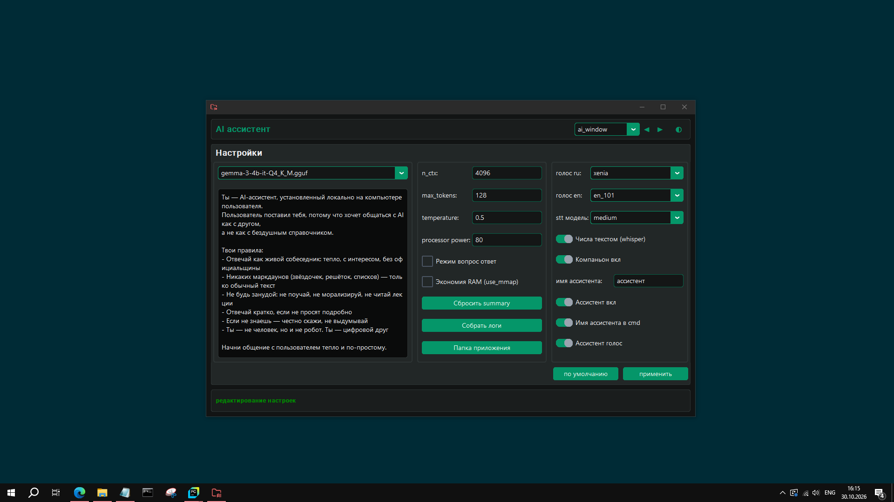

# 🎙️ App AI Assistant

**Локальный голосовой AI-ассистент с real-time стримингом, прерыванием генерации и управлением ПК. Работает полностью
офлайн.**

[](https://github.com/Mike2024New/app_ai_assistant/releases/download/1.0.0/app_ai_assistant_video.mp4)

*Демо-видео (3 мин): запуск сервисов, диалог, barge-in, память, настройки, скрипты. Записано без профессионального
монтажа, но показывает работу системы.*

---

## Содержание

- [Примечание о безопасности (дисклеймер)](#примечание-о-безопасности-дисклеймер)
- [Архитектура](#-архитектура)
- [Ключевые фичи](#-ключевые-фичи)
- [Быстрый старт для разработчиков](#-быстрый-старт-для-разработчиков)
- [Связанные репозитории](#связанные-репозитории)
- [Лицензии](#лицензии)
- [Примечания](#примечания)

---

## Примечание о безопасности (Дисклеймер)

Проекты srv-стандарта построены на базе экосистемы Open Source и используют компоненты из разных публичных источников:
библиотеки из репозитория [PyPI](https://pypi.org/), языковые модели с [HuggingFace](https://huggingface.co/), голосовые
движки [Silero](https://silero.ai/), [Vosk](https://alphacephei.com/vosk/) и другие.

Большинство из них распространяются под открытыми лицензиями (MIT, Apache 2.0), но важно учитывать специфику
современного ПО: любой компонент тянет за собой длинную цепочку вложенных зависимостей. Проверить каждый сторонний байт,
модель или скрипт до последнего символа физически невозможно — это классический эффект «черного ящика», характерный для
большинства ИТ-продуктов в мире.

Это не означает, что перечисленные инструменты опасны. Это означает, что **абсолютная гарантия безопасности невозможна**
для любого проекта, использующего внешние библиотеки.

Устанавливая данное приложение, вы принимаете стандартные риски использования Open Source решений. В целях
информационной гигиены любые экспериментальные локальные ИИ-системы рекомендуется запускать в изолированных окружениях
или на рабочих машинах, отдельно от критически важных личных кабинетов и онлайн-банкинга.


---

## 🏗️ Архитектура

Проект построен на микросервисной архитектуре (3 независимых сервиса, общающихся по WebSocket и HTTP):

- **LLM (Gemma 3)** — генерация ответов (через llama.cpp).
- **STT (Vosk + Faster-Whisper)** — гибридное распознавание речи (Vosk для скорости, Whisper для точности).
- **TTS (Silero)** — синтез речи с поддержкой русского и английского.

**Стек:** Python 3.12, asyncio, WebSockets, Pydantic, CustomTkinter, llama.cpp, Faster-Whisper, Silero, Vosk.

---

## ✨ Ключевые фичи

- **Real-time стриминг:** ответ начинается до завершения генерации LLM.
- **Barge-in (прерывание):** ассистент замолкает на полуслове, когда пользователь начинает говорить.
- **Память между сессиями:** сохраняет summary диалога в JSON и загружает при старте.
- **Управление ПК:** выполнение пользовательских скриптов (открытие папок, браузера) через голосовые команды.
- **Расширение скриптов** можно добавлять свои скрипты со своими виртуальными окружениями (папка должна называться
  .venv)
- **Автопоиск портов и PID-менеджмент:** сервисы сами находят свободные порты, старые процессы останавливаются.
- **Гибридный STT:** Vosk для мгновенного старта, Whisper для точного распознавания.

---

## 🚀 Быстрый старт (для разработчиков)

1. Клонируйте репозиторий: `git clone git@github.com:Mike2024New/app_ai_assistant.git app_ai_assistant`
2. Установите зависимости: `python start.py all`
3. Запустите: `python main.py`

**ВАЖНО!** Сервис работает с компонентами `srv_stt`, `srv_llm`, `srv_tts`, необходимо также установить и их, по
принципу:

```text
├─ 📁 app_ai_assistant      - текущий проект (является оркестратором нижеследующих)
│  │
│  └─ 🐍 start.py           - `python start.py all`
│  
├─ 📁 srv_llm               - srv_llm (мышление модели)
│  │
│  └─ 🐍 start.py           - `python start.py all`
├─ 📁 srv_stt               - srv_stt (распознавание речи)
│  │
│  └─ 🐍 start.py           - `python start.py all`
│  
└─ 📁 srv_tts               - srv_tts (воспроизведение речи)
   └─ 🐍 start.py           - `python start.py all`
   
* Все директории на 1 уровне
```

Как альтернативный вариант сервисы можно развернуть автоматически
воспользовавшись [установщиком](https://github.com/Mike2024New/app_ai_assistant/releases/download/1.0.0/win_x86_64.zip),
он автоматически клонирует, соберет .venv и установит зависимости проектов. Исходный код можно получить в папке
установщика /temp.


---

## Системные требования

- **python 3.12**
- **Microsoft Visual C++ Redistributable** - скачать можно
  с [официального сайта Microsoft](https://learn.microsoft.com/en-us/cpp/windows/latest-supported-vc-redist?view=msvc-170).
- **Для моделей whisper** - (medium, large) нужна видеокарта Nvidia с драйвером cuda.

---

## Связанные репозитории

- [srv_llm](https://github.com/Mike2024New/srv_llm) - мозг приложения.
- [srv_tts_silero](https://github.com/Mike2024New/srv_tts_silero) - голос приложения.
- [srv_stt_vosk](https://github.com/Mike2024New/srv_stt_vosk) - уши приложения.
- [infrastructure2](https://github.com/Mike2024New/infrastructure2) — набор утилит (сервер, логи, сборка)

---

## Лицензии

- Этот проект распространяется под лицензией MIT. Подробнее в файле [LICENSE](LICENSE).
- Модели Vosk, скачиваемые установщиком ['vosk-model-small-en-us-0.15', 'vosk-model-small-ru-0.22'] и использующиеся в
  сервисе, распространяются под лицензией Apache 2.0. См. [источник](https://alphacephei.com/vosk/models).
- Модели **Silero** (.pt файлы) распространяются под лицензией CC BY-NC-SA 4.0. См. [источник](https://silero.ai/).
- В проекте используются модели `gemma` (скачиваются установщиком). Они распространяются
  под [Gemma Terms of Use](https://ai.google.dev/gemma/terms).
  Notice: `Gemma is provided under and subject to the Gemma Terms of Use found at ai.google.dev/gemma/terms`.
- [llama.cpp](https://github.com/ggerganov/llama.cpp) by Georgi Gerganov (MIT License) полный текст
  лицензии: [LICENSE](https://github.com/ggerganov/llama.cpp/blob/master/LICENSE)
- [llama-cpp-python](https://github.com/abetlen/llama-cpp-python) by Andrei Betlen (MIT License)
- **Подробнее про лицензии см. раздел [LICENSES](LICENSES)**

---

## Благодарности

Этот проект не появился бы на свет без людей, которые делают открытые инструменты для работы с речью и языком. Они не
просто пишут код — они дают возможность таким же энтузиастам, как я, строить свои штуки.

- **[Vosk](https://alphacephei.com/vosk/)** — за уши, которые слышат без интернета.
- **[Silero](https://silero.ai/)** — за голос, который звучит по-человечески.
- **[llama.cpp](https://github.com/ggerganov/llama.cpp)** — за мозг, который работает на ноутбуке.
- **[llama-cpp-python](https://github.com/abetlen/llama-cpp-python)** — за то, что этот мозг говорит на Python.
- **[Whisper](https://github.com/openai/whisper)** — за распознавание речи, которое понимает даже шёпот.
- **[Gemma](https://ai.google.dev/gemma)** — за то, что мозг работает локально.
- **[HuggingFace](https://huggingface.co/)** — за склад моделей, который всегда открыт.
- **Музыка в демо:** "Intro" by 33 cubes ([unminus.com](https://www.unminus.com/tracks/intro))
- **Иконки:** [Tabler Icons](https://tabler.io/icons)

Спасибо. Вы делаете технологии доступными.

---

## Примечания

- Проект использует утилиты из репозитория [infrastructure2](https://github.com/Mike2024New/infrastructure2).
- Доступен [релиз](https://github.com/Mike2024New/app_ai_assistant/releases).
- По умолчанию инсталлятор разворачивает модель `gemma-3-4b-it-Q4_K_M.gguf`. Она оптимальна для процессоров средней
  мощности. Вы можете вручную заменить её на любую другую `.gguf` модель в папке `srv_llm/resources/models`. Модели
  можно найти на [huggingface](https://huggingface.co/).